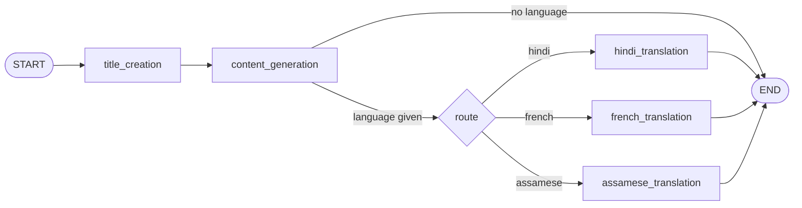

# 🌐 Multilingual AI Blog Generator

An agentic blog-writing app that turns a topic into an SEO-friendly blog post and can translate it into **Hindi, French or Assamese**. The workflow is orchestrated with **LangGraph**, powered by **Groq** (Llama 3.1 8B), served through a **FastAPI** backend and used through a **Streamlit** frontend.

🔗 **Live app:** https://multilangbloggenerator-8uad6k88jn6b5akfsstgbc.streamlit.app/
🔗 **API endpoint:** `POST https://multi-lang-blog-generator.onrender.com/blogs`

> The backend runs on Render's free tier, so the first request after a period of inactivity may take up to a minute while the server wakes up.


---

## ✨ Features

- **Topic → full blog post:** generates a creative, SEO-friendly title, then long-form Markdown content.
- **Multilingual output:** translates the post into Hindi, French or Assamese while keeping the original tone and formatting and adapting idioms. English is the default.
- **Agentic workflow:** a LangGraph state graph with conditional routing that picks the translation node for the requested language.
- **Structured output:** translations are parsed into a Pydantic `Blog` schema (`title`, `content`).
- **REST API + UI:** a FastAPI endpoint that any client can call, plus a Streamlit interface.
- **Observability:** works with LangSmith and LangGraph Studio for tracing and visual debugging.

---

## 🧠 How it works



The API builds one of two graphs depending on the request:

| Request | Graph | Steps |
|---|---|---|
| `topic` only | Topic graph | title → content |
| `topic` + `language` | Language graph | title → content → route → translation |

All nodes share a typed `BlogState` (`topic`, `blog`, `current_language`).

---

## 🛠️ Tech stack

| Layer | Tools |
|---|---|
| LLM | Groq, `llama-3.1-8b-instant` via `langchain-groq` |
| Orchestration | LangGraph, LangChain |
| Backend | FastAPI, Uvicorn (deployed on Render) |
| Frontend | Streamlit (deployed on Streamlit Community Cloud) |
| Validation | Pydantic |
| Tooling | uv, LangSmith, LangGraph CLI / Studio |

---

## 📁 Project structure

```
multi_lang_blog_generator/
├── app.py                  # FastAPI app exposing POST /blogs
├── streamlit_app.py        # Streamlit frontend
├── langgraph.json          # LangGraph Studio config
├── src/
│   ├── graphs/
│   │   └── graph_builder.py  # Builds the topic and language graphs
│   ├── nodes/
│   │   └── blog_node.py      # Title, content, translation and routing nodes
│   ├── llms/
│   │   └── groqllm.py        # Groq LLM setup
│   └── states/
│       └── blogstate.py      # BlogState and Blog schema
├── requirements.txt
└── pyproject.toml
```

---

## 🚀 Run locally

### 1. Prerequisites

- Python 3.13+
- [uv](https://docs.astral.sh/uv/) (recommended) or pip
- A [Groq API key](https://console.groq.com/keys)
- A [LangSmith API key](https://smith.langchain.com/) (used for tracing)

### 2. Clone and install

```bash
git clone https://github.com/aijulhussain/multi_lang_blog_generator.git
cd multi_lang_blog_generator

# with uv
uv sync

# or with pip
python -m venv .venv
.venv\Scripts\activate        # Windows
# source .venv/bin/activate   # macOS/Linux
pip install -r requirements.txt
```

### 3. Set environment variables

Create a `.env` file in the project root:

```env
GROQ_API_KEY=your_groq_api_key
LANGSMITH_API_KEY=your_langsmith_api_key
LANGCHAIN_API_KEY=your_langsmith_api_key
```

### 4. Start the backend

```bash
uvicorn app:app --reload
```

The API is now running at `http://localhost:8000`, with interactive docs at `http://localhost:8000/docs`.

### 5. Start the frontend

In a second terminal:

```bash
streamlit run streamlit_app.py
```

> `streamlit_app.py` calls the deployed Render API by default. To use your local backend, change the URL in the `requests.post(...)` call to `http://localhost:8000/blogs`.

### 6. (Optional) Open the graph in LangGraph Studio

```bash
langgraph dev
```

This loads `blog_generator_agent` from `langgraph.json` so you can view and step through the graph visually.

---

## 📡 API usage

**`POST /blogs`**

Generate an English blog:

```bash
curl -X POST http://localhost:8000/blogs \
  -H "Content-Type: application/json" \
  -d '{"topic": "Agentic AI"}'
```

Generate a blog and translate it:

```bash
curl -X POST http://localhost:8000/blogs \
  -H "Content-Type: application/json" \
  -d '{"topic": "Agentic AI", "language": "french"}'
```

| Field | Type | Required | Description |
|---|---|---|---|
| `topic` | string | ✅ | Subject of the blog post |
| `language` | string | ❌ | `hindi`, `french` or `assamese` (case-insensitive) |

The response contains the final graph state under `data`, including the generated `blog`.

---

## 🔮 Future improvements

- Support more languages from a configurable list.
- Stream tokens to the UI as the blog is generated.
- Add input validation and clearer error responses.
- Add tests for the graph nodes and the API.

---

